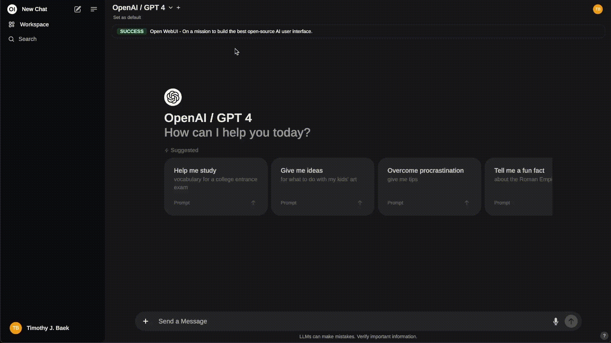

# AonzOG Open WebUI — BSD 3-Clause Historical Snapshot 11-10-2026

This repository contains an imported historical snapshot of **Open WebUI**, preserved from a specific upstream revision released under the **BSD 3-Clause License**.

The purpose of this repository is to retain an independently maintained copy of the Open WebUI codebase as it existed at the selected revision, allowing subsequent development, modification, integration, redistribution, and commercial use in accordance with the applicable licence conditions.

## 1. Original Repository and Source Revision

| Information | Details |
|---|---|
| Original project | Open WebUI |
| Original repository | https://github.com/open-webui/open-webui |
| Upstream default branch | `main` |
| Source reference type | Historical commit-pinned snapshot (not a separately named branch) |
| Source branch/snapshot link | https://github.com/open-webui/open-webui/tree/3e7bce092129c5a9c98f268b3af0fca6971a40d3 |
| Original commit ID / SHA-1 | `3e7bce092129c5a9c98f268b3af0fca6971a40d3` |
| Original commit date | 18 April 2025, 19:32:17 UTC |
| **Number of upstream commits through this revision** | **10,105 (inclusive)** |
| Git tree SHA-1 | `7b966b947ca7dab6dc547e4d19196b11007e424d` |
| Licence at selected revision | BSD 3-Clause License (`BSD-3-Clause`) |

**Commit count clarification:** The **10,105** upstream commits represent the Git history reachable from the selected source commit, including that commit and its ancestors (including merged history). The count was verified using the GitHub commits API for the exact revision: page 10,105 contains the repository's initial commit and page 10,106 is empty when using `per_page=1`. This is **not** the number of commits in the destination repository.

The source snapshot URL resolves to a historical commit on the original repository's history rather than a separately named branch. This pin identifies the original revision even as the upstream project's `main` branch continues to change.

## 2. Imported Repository Details

| Information | Details |
|---|---|
| Repository name | `open-webui-BSD-3-Clause` |
| Repository owner | `AonzOG` |
| Repository URL | https://github.com/AonzOG/open-webui-BSD-3-Clause |
| Destination branch | `main` |
| Destination branch URL | https://github.com/AonzOG/open-webui-BSD-3-Clause/tree/main |
| Completed source import commit | `b40aece76125b3de584b473d703cb281767b2a9a` |
| Completed import commit URL | https://github.com/AonzOG/open-webui-BSD-3-Clause/commit/b40aece76125b3de584b473d703cb281767b2a9a |
| Import date | 11 October 2026 |
| Original licence preserved | BSD 3-Clause License |
| Source tree integrity | Verified — exact Git tree SHA match |

The source files were imported directly into the destination repository, which has **independent Git history**. The destination's `main` branch contained **6 commits** immediately after completion of the import. The original upstream history of **10,105 commits** was not reproduced in the destination's Git history; the historical source revision is documented and its complete tracked file tree was imported.

## 3. Source Integrity and Version Identification

The imported source tree was verified against the original Open WebUI revision.

**Original upstream commit SHA-1:**

`3e7bce092129c5a9c98f268b3af0fca6971a40d3`

**Original upstream Git tree SHA-1:**

`7b966b947ca7dab6dc547e4d19196b11007e424d`

**Imported repository Git tree SHA-1 (at completed import):**

`7b966b947ca7dab6dc547e4d19196b11007e424d`

The identical Git tree hashes establish that the tracked file contents, paths, and Git file modes matched the original upstream snapshot at the completed import commit.

This verification describes **the original imported source revision**. Later changes — including replacement of this README — will produce a different destination tree hash without altering the recorded identity of the historical import.

## 4. Licensing and Attribution

The selected Open WebUI revision contains the **BSD 3-Clause License**, whose original licence and copyright notice have been preserved in this repository.

**Original project:** Open WebUI

**Original copyright notice:** Copyright (c) 2023-2025 Timothy Jaeryang Baek

**Original licence:** BSD 3-Clause License (`BSD-3-Clause`)

**Original licence file:**

https://github.com/open-webui/open-webui/blob/3e7bce092129c5a9c98f268b3af0fca6971a40d3/LICENSE

The BSD 3-Clause License permits use, modification, redistribution, and commercial exploitation in source and binary forms, subject to its conditions. Redistributions of source must retain the required copyright notice, conditions, and disclaimer; binary redistributions must reproduce those notices in associated materials. The names of the copyright holder and contributors may not be used to endorse or promote derivatives without prior written permission. Separately licensed third-party components remain subject to their own licence terms.

The repository owner's independently written additions may carry their own applicable notices, but importing or modifying the upstream project does not transfer authorship of its pre-existing code or remove the original attribution obligations.

## 5. Repository Maintenance and Development

This repository establishes the specified historical BSD 3-Clause-licensed Open WebUI revision as its initial imported codebase. Future development, bug fixes, security improvements, feature additions, integrations, and rebranding may be undertaken independently by the repository owner, subject to applicable licences.

The repository is **not automatically synchronized** with current upstream Open WebUI releases. Later upstream code or licensing changes do not automatically change the legal terms of the particular historical source files imported here.

**Installation and workflow note:** The original Open WebUI README below is reproduced without changes. References in that historical README to `pip install open-webui`, `ghcr.io/open-webui/open-webui`, upstream documentation, sponsorship, support, and releases refer to the original upstream project; they do not establish that independently maintained builds or packages have been published from this repository. The imported upstream GitHub Actions workflows should be reviewed before use because release and publication workflows can run automatically.

For the immutable record of the initial import, refer to:

- **Original source snapshot:** https://github.com/open-webui/open-webui/tree/3e7bce092129c5a9c98f268b3af0fca6971a40d3
- **Original source commit:** https://github.com/open-webui/open-webui/commit/3e7bce092129c5a9c98f268b3af0fca6971a40d3
- **Original source licence:** https://github.com/open-webui/open-webui/blob/3e7bce092129c5a9c98f268b3af0fca6971a40d3/LICENSE
- **Completed destination import:** https://github.com/AonzOG/open-webui-BSD-3-Clause/commit/b40aece76125b3de584b473d703cb281767b2a9a

---

**Original Open WebUI README follows below, retained without modification.**


# Open WebUI 👋


[](https://discord.gg/5rJgQTnV4s)
[](https://github.com/sponsors/tjbck)

**Open WebUI is an [extensible](https://docs.openwebui.com/features/plugin/), feature-rich, and user-friendly self-hosted AI platform designed to operate entirely offline.** It supports various LLM runners like **Ollama** and **OpenAI-compatible APIs**, with **built-in inference engine** for RAG, making it a **powerful AI deployment solution**.



> [!TIP]  
> **Looking for an [Enterprise Plan](https://docs.openwebui.com/enterprise)?** – **[Speak with Our Sales Team Today!](mailto:sales@openwebui.com)**
>
> Get **enhanced capabilities**, including **custom theming and branding**, **Service Level Agreement (SLA) support**, **Long-Term Support (LTS) versions**, and **more!**

For more information, be sure to check out our [Open WebUI Documentation](https://docs.openwebui.com/).

## Key Features of Open WebUI ⭐

- 🚀 **Effortless Setup**: Install seamlessly using Docker or Kubernetes (kubectl, kustomize or helm) for a hassle-free experience with support for both `:ollama` and `:cuda` tagged images.

- 🤝 **Ollama/OpenAI API Integration**: Effortlessly integrate OpenAI-compatible APIs for versatile conversations alongside Ollama models. Customize the OpenAI API URL to link with **LMStudio, GroqCloud, Mistral, OpenRouter, and more**.

- 🛡️ **Granular Permissions and User Groups**: By allowing administrators to create detailed user roles and permissions, we ensure a secure user environment. This granularity not only enhances security but also allows for customized user experiences, fostering a sense of ownership and responsibility amongst users.

- 📱 **Responsive Design**: Enjoy a seamless experience across Desktop PC, Laptop, and Mobile devices.

- 📱 **Progressive Web App (PWA) for Mobile**: Enjoy a native app-like experience on your mobile device with our PWA, providing offline access on localhost and a seamless user interface.

- ✒️🔢 **Full Markdown and LaTeX Support**: Elevate your LLM experience with comprehensive Markdown and LaTeX capabilities for enriched interaction.

- 🎤📹 **Hands-Free Voice/Video Call**: Experience seamless communication with integrated hands-free voice and video call features, allowing for a more dynamic and interactive chat environment.

- 🛠️ **Model Builder**: Easily create Ollama models via the Web UI. Create and add custom characters/agents, customize chat elements, and import models effortlessly through [Open WebUI Community](https://openwebui.com/) integration.

- 🐍 **Native Python Function Calling Tool**: Enhance your LLMs with built-in code editor support in the tools workspace. Bring Your Own Function (BYOF) by simply adding your pure Python functions, enabling seamless integration with LLMs.

- 📚 **Local RAG Integration**: Dive into the future of chat interactions with groundbreaking Retrieval Augmented Generation (RAG) support. This feature seamlessly integrates document interactions into your chat experience. You can load documents directly into the chat or add files to your document library, effortlessly accessing them using the `#` command before a query.

- 🔍 **Web Search for RAG**: Perform web searches using providers like `SearXNG`, `Google PSE`, `Brave Search`, `serpstack`, `serper`, `Serply`, `DuckDuckGo`, `TavilySearch`, `SearchApi` and `Bing` and inject the results directly into your chat experience.

- 🌐 **Web Browsing Capability**: Seamlessly integrate websites into your chat experience using the `#` command followed by a URL. This feature allows you to incorporate web content directly into your conversations, enhancing the richness and depth of your interactions.

- 🎨 **Image Generation Integration**: Seamlessly incorporate image generation capabilities using options such as AUTOMATIC1111 API or ComfyUI (local), and OpenAI's DALL-E (external), enriching your chat experience with dynamic visual content.

- ⚙️ **Many Models Conversations**: Effortlessly engage with various models simultaneously, harnessing their unique strengths for optimal responses. Enhance your experience by leveraging a diverse set of models in parallel.

- 🔐 **Role-Based Access Control (RBAC)**: Ensure secure access with restricted permissions; only authorized individuals can access your Ollama, and exclusive model creation/pulling rights are reserved for administrators.

- 🌐🌍 **Multilingual Support**: Experience Open WebUI in your preferred language with our internationalization (i18n) support. Join us in expanding our supported languages! We're actively seeking contributors!

- 🧩 **Pipelines, Open WebUI Plugin Support**: Seamlessly integrate custom logic and Python libraries into Open WebUI using [Pipelines Plugin Framework](https://github.com/open-webui/pipelines). Launch your Pipelines instance, set the OpenAI URL to the Pipelines URL, and explore endless possibilities. [Examples](https://github.com/open-webui/pipelines/tree/main/examples) include **Function Calling**, User **Rate Limiting** to control access, **Usage Monitoring** with tools like Langfuse, **Live Translation with LibreTranslate** for multilingual support, **Toxic Message Filtering** and much more.

- 🌟 **Continuous Updates**: We are committed to improving Open WebUI with regular updates, fixes, and new features.

Want to learn more about Open WebUI's features? Check out our [Open WebUI documentation](https://docs.openwebui.com/features) for a comprehensive overview!

## 🔗 Also Check Out Open WebUI Community!

Don't forget to explore our sibling project, [Open WebUI Community](https://openwebui.com/), where you can discover, download, and explore customized Modelfiles. Open WebUI Community offers a wide range of exciting possibilities for enhancing your chat interactions with Open WebUI! 🚀

## How to Install 🚀

### Installation via Python pip 🐍

Open WebUI can be installed using pip, the Python package installer. Before proceeding, ensure you're using **Python 3.11** to avoid compatibility issues.

1. **Install Open WebUI**:
   Open your terminal and run the following command to install Open WebUI:

   ```bash
   pip install open-webui
   ```

2. **Running Open WebUI**:
   After installation, you can start Open WebUI by executing:

   ```bash
   open-webui serve
   ```

This will start the Open WebUI server, which you can access at [http://localhost:8080](http://localhost:8080)

### Quick Start with Docker 🐳

> [!NOTE]  
> Please note that for certain Docker environments, additional configurations might be needed. If you encounter any connection issues, our detailed guide on [Open WebUI Documentation](https://docs.openwebui.com/) is ready to assist you.

> [!WARNING]
> When using Docker to install Open WebUI, make sure to include the `-v open-webui:/app/backend/data` in your Docker command. This step is crucial as it ensures your database is properly mounted and prevents any loss of data.

> [!TIP]  
> If you wish to utilize Open WebUI with Ollama included or CUDA acceleration, we recommend utilizing our official images tagged with either `:cuda` or `:ollama`. To enable CUDA, you must install the [Nvidia CUDA container toolkit](https://docs.nvidia.com/dgx/nvidia-container-runtime-upgrade/) on your Linux/WSL system.

### Installation with Default Configuration

- **If Ollama is on your computer**, use this command:

  ```bash
  docker run -d -p 3000:8080 --add-host=host.docker.internal:host-gateway -v open-webui:/app/backend/data --name open-webui --restart always ghcr.io/open-webui/open-webui:main
  ```

- **If Ollama is on a Different Server**, use this command:

  To connect to Ollama on another server, change the `OLLAMA_BASE_URL` to the server's URL:

  ```bash
  docker run -d -p 3000:8080 -e OLLAMA_BASE_URL=https://example.com -v open-webui:/app/backend/data --name open-webui --restart always ghcr.io/open-webui/open-webui:main
  ```

- **To run Open WebUI with Nvidia GPU support**, use this command:

  ```bash
  docker run -d -p 3000:8080 --gpus all --add-host=host.docker.internal:host-gateway -v open-webui:/app/backend/data --name open-webui --restart always ghcr.io/open-webui/open-webui:cuda
  ```

### Installation for OpenAI API Usage Only

- **If you're only using OpenAI API**, use this command:

  ```bash
  docker run -d -p 3000:8080 -e OPENAI_API_KEY=your_secret_key -v open-webui:/app/backend/data --name open-webui --restart always ghcr.io/open-webui/open-webui:main
  ```

### Installing Open WebUI with Bundled Ollama Support

This installation method uses a single container image that bundles Open WebUI with Ollama, allowing for a streamlined setup via a single command. Choose the appropriate command based on your hardware setup:

- **With GPU Support**:
  Utilize GPU resources by running the following command:

  ```bash
  docker run -d -p 3000:8080 --gpus=all -v ollama:/root/.ollama -v open-webui:/app/backend/data --name open-webui --restart always ghcr.io/open-webui/open-webui:ollama
  ```

- **For CPU Only**:
  If you're not using a GPU, use this command instead:

  ```bash
  docker run -d -p 3000:8080 -v ollama:/root/.ollama -v open-webui:/app/backend/data --name open-webui --restart always ghcr.io/open-webui/open-webui:ollama
  ```

Both commands facilitate a built-in, hassle-free installation of both Open WebUI and Ollama, ensuring that you can get everything up and running swiftly.

After installation, you can access Open WebUI at [http://localhost:3000](http://localhost:3000). Enjoy! 😄

### Other Installation Methods

We offer various installation alternatives, including non-Docker native installation methods, Docker Compose, Kustomize, and Helm. Visit our [Open WebUI Documentation](https://docs.openwebui.com/getting-started/) or join our [Discord community](https://discord.gg/5rJgQTnV4s) for comprehensive guidance.

### Troubleshooting

Encountering connection issues? Our [Open WebUI Documentation](https://docs.openwebui.com/troubleshooting/) has got you covered. For further assistance and to join our vibrant community, visit the [Open WebUI Discord](https://discord.gg/5rJgQTnV4s).

#### Open WebUI: Server Connection Error

If you're experiencing connection issues, it’s often due to the WebUI docker container not being able to reach the Ollama server at 127.0.0.1:11434 (host.docker.internal:11434) inside the container . Use the `--network=host` flag in your docker command to resolve this. Note that the port changes from 3000 to 8080, resulting in the link: `http://localhost:8080`.

**Example Docker Command**:

```bash
docker run -d --network=host -v open-webui:/app/backend/data -e OLLAMA_BASE_URL=http://127.0.0.1:11434 --name open-webui --restart always ghcr.io/open-webui/open-webui:main
```

### Keeping Your Docker Installation Up-to-Date

In case you want to update your local Docker installation to the latest version, you can do it with [Watchtower](https://containrrr.dev/watchtower/):

```bash
docker run --rm --volume /var/run/docker.sock:/var/run/docker.sock containrrr/watchtower --run-once open-webui
```

In the last part of the command, replace `open-webui` with your container name if it is different.

Check our Updating Guide available in our [Open WebUI Documentation](https://docs.openwebui.com/getting-started/updating).

### Using the Dev Branch 🌙

> [!WARNING]
> The `:dev` branch contains the latest unstable features and changes. Use it at your own risk as it may have bugs or incomplete features.

If you want to try out the latest bleeding-edge features and are okay with occasional instability, you can use the `:dev` tag like this:

```bash
docker run -d -p 3000:8080 -v open-webui:/app/backend/data --name open-webui --add-host=host.docker.internal:host-gateway --restart always ghcr.io/open-webui/open-webui:dev
```

### Offline Mode

If you are running Open WebUI in an offline environment, you can set the `HF_HUB_OFFLINE` environment variable to `1` to prevent attempts to download models from the internet.

```bash
export HF_HUB_OFFLINE=1
```

## What's Next? 🌟

Discover upcoming features on our roadmap in the [Open WebUI Documentation](https://docs.openwebui.com/roadmap/).

## License 📜

This project is licensed under the [BSD-3-Clause License](LICENSE) - see the [LICENSE](LICENSE) file for details. 📄

## Support 💬

If you have any questions, suggestions, or need assistance, please open an issue or join our
[Open WebUI Discord community](https://discord.gg/5rJgQTnV4s) to connect with us! 🤝

## Star History

<a href="https://star-history.com/#open-webui/open-webui&Date">
  <picture>
    <source media="(prefers-color-scheme: dark)" srcset="https://api.star-history.com/svg?repos=open-webui/open-webui&type=Date&theme=dark" />
    <source media="(prefers-color-scheme: light)" srcset="https://api.star-history.com/svg?repos=open-webui/open-webui&type=Date" />
    
  </picture>
</a>

---

Created by [Timothy Jaeryang Baek](https://github.com/tjbck) - Let's make Open WebUI even more amazing together! 💪
